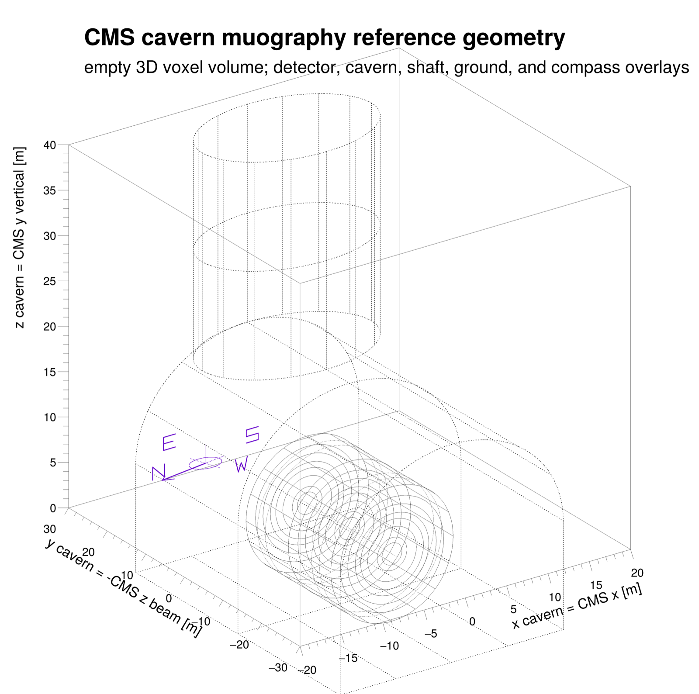

# CMS Cavern Muography

This repository organizes a small CMS cavern-muography pipeline. It converts
2025 CMS cosmic-muon AOD into a 3D voxel map, builds an EXPACS/PARMA
solid-overburden expectation, applies a broad data/MC correction, computes
Li-Ma cavity significances, and writes ROOT canvases deccorrated with outlines of 
UXC, the CMS detector, and the shaft.

## Coordinate Convention

The analysis display frame takes the cavern coordinates:

- `x = CMS global x`
- `y = -CMS global z`, the horizontal beam-pipe axis
- `z = CMS global y`, vertically upward

Muon rays are painted toward positive cavern `z`. 



## Input Dataset

The example uses CMS cosmics AOD from:

```text
/Cosmics/OORun2025-PromptReco-v1/AOD
```

On lxplus or your working file system, you can do

## Run The Pipeline

```bash
# Environment
cmsrel CMSSW_16_1_0_pre4
cd CMSSW_16_1_0_pre4/src
cmsenv
cd ../../
git clone https://github.com/sbein/CmsMuography/ #or your fork
cd CmsMuography

# 1. Reconstruct the data voxel map
python3 scripts/cosmic_voxel_map.py -i data/OORun2025_AOD_small3.txt -o test_output/OORun2025_AOD_voxel_map_zup.root

# 2. Generate and propagate the EXPACS/PARMA solid-ground expectation
./scripts/build_expacs_wrapper.sh
./expacs/expacs_muon_grid
python3 scripts/make_generated_solid_ground_expectation.py --template-root test_output/OORun2025_AOD_voxel_map_zup.root --flux-table test_output/expacs_muon_flux_grid_cms_p5.csv -o test_output/generated_solid_ground_bethe_reverse_2M.root

# 3. Form and broadly correct the data/MC Li-Ma volume
python3 scripts/make_lima_volume.py --observed-root test_output/OORun2025_AOD_voxel_map_zup.root --expected-root test_output/generated_solid_ground_bethe_reverse_2M.root -o test_output/OORun2025_classic_lima_alpha0p05.root
python3 scripts/calibrate_lima_expectation.py -i test_output/OORun2025_classic_lima_alpha0p05.root -o test_output/OORun2025_smoothcalib_lima_alpha0p05.root

# 4. Make the decorated data, MC, correction, and Li-Ma displays
python3 scripts/make_lima_slice_stacks.py -i test_output/OORun2025_smoothcalib_lima_alpha0p05.root -o test_output/OORun2025_smoothcalib_lima_displays.root --png-dir test_output/OORun2025_smoothcalib_lima_png
```
