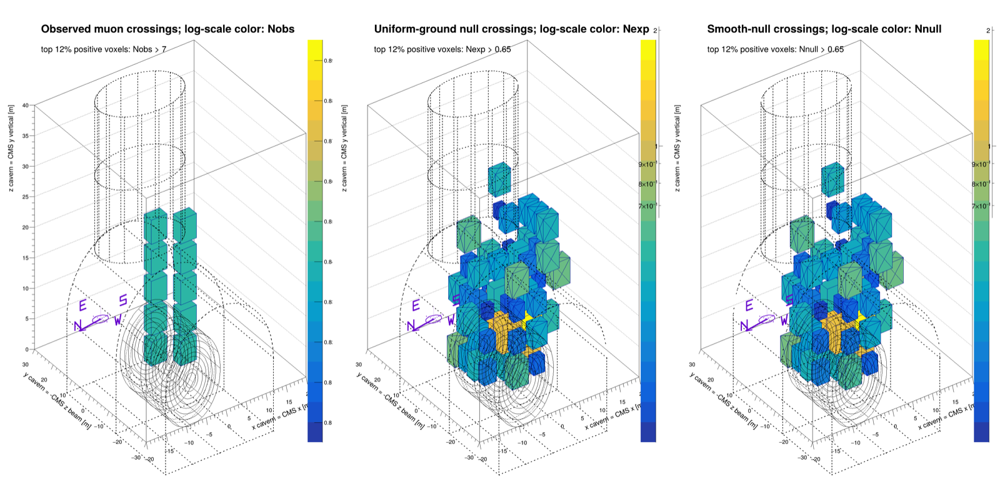
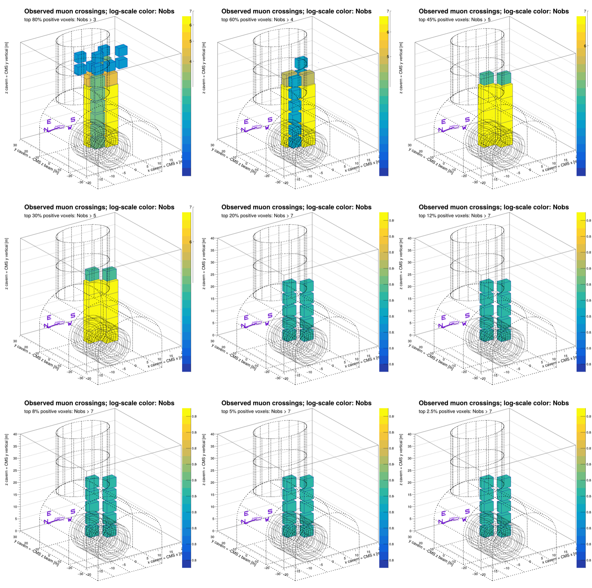
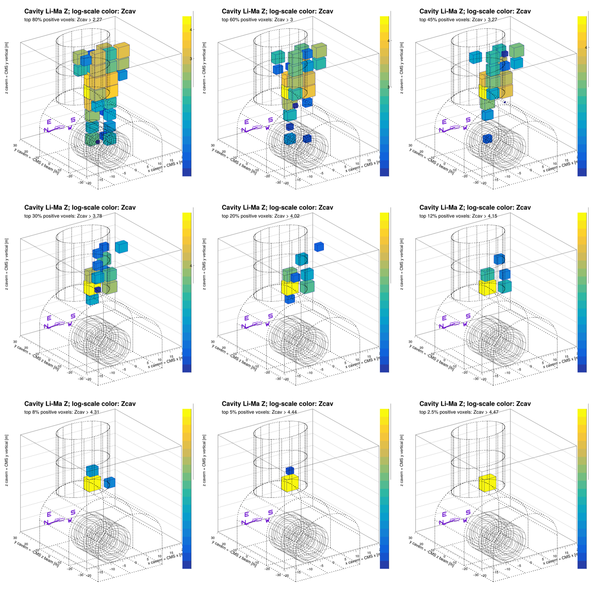

# CMS Cavern Muography

This repository contains a reproducible starter pipeline for CMS cavern
muography with 2025 CMS cosmic AOD data. It builds a z-up voxel occupancy map
from reconstructed cosmic muons, constructs an EXPACS/PARMA-inspired solid
overburden null, computes Li-Ma/profile-likelihood cavity evidence volumes,
and makes decorated ROOT canvases with CMS/cavern/ground/compass overlays.

The code is intentionally lightweight: CMSSW/FWLite/PyROOT for AOD and ROOT
histograms, plus small Python scripts and Condor wrappers. Large generated
ROOT files and full PNG collections are not committed.

## Coordinate Convention

The analysis display frame is the cavern frame:

- `x = CMS global x`
- `y = -CMS global z`, the beam-pipe axis, horizontal through the barrel
- `z = CMS global y`, physically upward out of the cavern

Histograms are stored internally in cm unless a display script is asked for
`--plot-units m`. The standard display uses meters. Muon ray painting is
clipped to the upward side by default, so the map represents trajectories
propagated toward positive cavern `z`. The minus sign on the beam coordinate
keeps this z-up frame right-handed and matches the transform stored in the
ROOT metadata.

## Repository Layout

- `scripts/`: AOD reading, voxel painting, null generation, Li-Ma volumes,
  display canvases, and Condor wrappers.
- `data/`: collaborator-local DAS/Rucio/XRootD file lists.
- `expacs/`: local wrapper notes for EXPACS/PARMA surface flux tables.
- `docs/`: smoke-test route, small README figures, and collaborator notes.

## Quick Smoke Test

From the repository root on lxplus, start with the synthetic end-to-end smoke
pipeline. It loads the standard CMSSW area automatically:

```bash
RUNTIME=cmssw ./scripts/run_smoke_pipeline.sh
```

It exercises the histogram definition, empty reference canvas, EXPACS-format
flux interface, straight-line propagation, 3D ray painting, Li-Ma calculation,
broad calibration, observed/MC comparison, and decorated visualization. See
`docs/smoke_tests.md` for the lxplus setup and optional direct-AOD smoke.

## Environment On Lxplus

```bash
cd /afs/cern.ch/work/s/sbein/Muography/CmsCavern/CMSSW_16_1_0_pre4/src && source /cvmfs/cms.cern.ch/cmsset_default.sh && eval "$(scram runtime -sh)" && cd /afs/cern.ch/work/s/sbein/Muography/CmsCavern/CosmicMuography
```

Set `CMSSW_SRC` when using another CMSSW checkout. Remote CMS data access may
also require a valid grid proxy:

```bash
voms-proxy-init --voms cms --valid 192:00 && voms-proxy-info --timeleft
```

For Rucio discovery, load its environment separately:

```bash
source /cvmfs/cms.cern.ch/rucio/setup.sh
```

For remote AOD reads, the FNAL redirector was often robust:

```text
root://cmsxrootd.fnal.gov/
```

## Input Cosmic Dataset

The main first-pass sample was:

```text
/Cosmics/OORun2025-PromptReco-v1/AOD
```

Per-user DAS/Rucio/XRootD file lists are generated into `data/` and are not
normally tracked by Git. In the canonical lxplus working area one useful local
file list is:

```text
data/OORun2025_AOD_disk_root_one_pfn_per_file_xrdfs_readable_no_kipt.txt
```

The code also has helpers to regenerate or validate file lists:

```bash
./scripts/make_das_filelist.sh /Cosmics/OORun2025-PromptReco-v1/AOD 100 > data/OORun2025_AOD_100.txt && python3 scripts/check_xrootd_filelist.py data/OORun2025_AOD_100.txt --timeout 20
```

## Step 0: Define The Histogram And Reference Canvas

The observed and simulated branches use the same cavern-frame `TH3` binning.
The AOD step creates `cavern_muon_voxels`; the generated null reads that TH3
as a binning template and creates `generator_expected_voxels` with identical
axes. Each accepted ray is clipped to the 3D analysis bounds and increments
the crossed voxels, so the result is a true voxel-wise 3D occupancy rather
than a collection of projected 2D histograms.

The display step always writes `canvas_geometry_baseline_3d`, an empty version
of the analysis volume decorated with:

- the simplified CMS detector wireframe;
- the approximate cavern hall and PX56 shaft;
- the approximate ground surface;
- cavern-coordinate axis labels in meters;
- a 3D compass rose that rotates with the scene.


The wireframes are interpretive rather than survey-grade. Their dimensions
and coordinate metadata are recorded in the display ROOT file.

## Step 1: Build A Raw Voxel Map From AOD

Small direct test:

```bash
python3 scripts/cosmic_voxel_map.py --input data/OORun2025_AOD_100.txt --redirector root://cmsxrootd.fnal.gov/ --max-events 1000 --output test_output/OORun2025_small_voxel_map_zup.root --skip-bad-files
```

Robust per-file run, useful when individual disk replicas stall:

```bash
INPUT_LIST=data/OORun2025_AOD_100.txt ./scripts/run_voxel_map_per_file.sh
```

The raw map file contains:

- `cavern_muon_voxels`: TH3 of voxelized muon-line crossings.
- `tracks`: accepted-track diagnostics, including cavern-frame reference
  point and direction.
- `cutflow`: event/track/voxel counts.
- `config_json`: exact geometry, collection choice, and cuts.

If a run produced a good `tracks` tree but the TH3 needs to be rebuilt:

```bash
python3 scripts/rebuild_voxel_map_from_tracks.py --input test_output/OORun2025_AOD_voxel_map_zup_robust.root --output test_output/OORun2025_AOD_voxel_map_zup_rebuilt.root
```

## Step 2: Make The Solid-Ground Null

The preferred null is independent of the real angular distribution except for
broad later calibration. It samples EXPACS/PARMA surface muons, samples random
impact points through the finite CMS cylinder, propagates straight lines
through a uniform solid overburden to the ground surface, and computes survival
with a Bethe/radiative range model.

The local EXPACS wrapper is in `expacs/`; the upstream package is installed at
`../External/EXPACS` in the canonical lxplus area. Build the wrapper and make a
reproducible surface-flux table with:

```bash
./scripts/build_expacs_wrapper.sh && ./expacs/expacs_muon_grid --expacs-dir ../External/EXPACS --output test_output/expacs_muon_flux_grid_cms_p5.csv --year 2026 --month 8 --day 21 --w-index 0 --emin-mev 30000 --emax-mev 300000 --ne 120 --ncos 100
```

Generate one null file directly:

```bash
python3 scripts/make_generated_solid_ground_expectation.py --template-root test_output/OORun2025_AOD_voxel_map_zup_robust.root --flux-table test_output/expacs_muon_flux_grid_cms_p5.csv --output test_output/generated_solid_ground_bethe_reverse_2M.root
```

The current defaults encode the baseline workflow: reverse CMS-volume
sampling, two million throws, 30 GeV minimum surface energy, `cos(z) > 0.1`,
the standard CMS/cavern geometry, and the standard material/range model. Each
choice remains available as a command-line override; run the script with
`--help` to see them.

For large statistics, use the Condor wrapper:

```bash
mkdir -p logs && condor_submit scripts/submit_generated_reverse_null_120m.condor
```

If chunked outputs are produced, merge their `generator_expected_voxels`
histograms with:

```bash
python3 scripts/merge_voxel_maps.py --hist-name generator_expected_voxels --input-list test_output/generated_reverse_null_chunks_120m/successful_parts.txt --output test_output/generated_solid_ground_bethe_reverse_merged.root --skip-bad-files
```

## Step 3: Compute And Broadly Correct The Li-Ma Volume

Build the raw observed-versus-null volumes:

```bash
python3 scripts/make_lima_volume.py --observed-root test_output/OORun2025_AOD_voxel_map_zup_robust.root --expected-root test_output/generated_solid_ground_bethe_reverse_2M.root --output test_output/OORun2025_classic_lima_alpha0p05.root
```

The defaults select `cavern_muon_voxels`, `generator_expected_voxels`, global
normalization, Li-Ma significance, and `alpha = 0.05`.

Apply the deliberately broad correction field:

```bash
python3 scripts/calibrate_lima_expectation.py -i test_output/OORun2025_classic_lima_alpha0p05.root -o test_output/OORun2025_smoothcalib_lima_alpha0p05.root
```

The default calibration is the established broad `zxy-poly` model with the
baseline smoothing scales. Its detailed smoothing, robustness, and clipping
parameters are optional overrides rather than part of the ordinary workflow.

Important output histograms include:

- `observed_voxels`
- `expected_voxels_global_scaled`
- `calibrated_expected_voxels`
- `smooth_calibration_factor`
- `observed_over_expected_calibrated`
- `signed_significance_calibrated`
- `cavity_excess_significance_calibrated`
- `log_transmission_excess`

## Step 4: Make Decorated Data, MC, And Li-Ma Displays

```bash
python3 scripts/make_lima_slice_stacks.py -i test_output/OORun2025_smoothcalib_lima_alpha0p05.root -o test_output/OORun2025_smoothcalib_lima_displays.root --png-dir test_output/OORun2025_smoothcalib_lima_png
```

The standard defaults now produce:

- the empty geometry-reference canvas;
- a side-by-side observed/raw-MC/corrected-MC 3D canvas;
- a 3x3 loose-to-tight threshold canvas for data-only voxel occupancy;
- equivalent 3D threshold canvases for raw and corrected MC;
- signed, positive-only cavity, and log-transmission Li-Ma canvases;
- XY slices in upward `z` and XZ slices in beam-axis `y`;
- meters, display rebinning by two, and suitable linear/log color choices.



The preview is a synthetic smoke-test product, not a physics result. For MC
closure or injected-cavity studies, substitute the simulated track-painted
TH3 for `--observed-root` in Step 3 and use the same remaining commands. This
keeps the data and MC Li-Ma definitions and canvases identical.

<details>
<summary>Show synthetic 3x3 occupancy and cavity-evidence threshold canvases</summary>





</details>

## Reproducibility Notes

- Do not commit large outputs; keep ROOT and production PNG products in
  `test_output/`, EOS, or another analysis storage area.
- The small images under `docs/figures/readme/` are synthetic documentation
  fixtures generated by the smoke test.
- The display geometry is approximate, documented in the ROOT metadata, and
  meant for interpretation rather than survey-grade CAD.
- Internal ROOT axes are usually cm. The standard display defaults to meters.
- Baseline choices live in script defaults and output metadata; use `--help`
  and command-line overrides for studies rather than expanding routine README
  commands.
- Avoid fitting calibration fields so flexibly that they absorb 50 m-scale
  cavities or vertically segmented variations.
